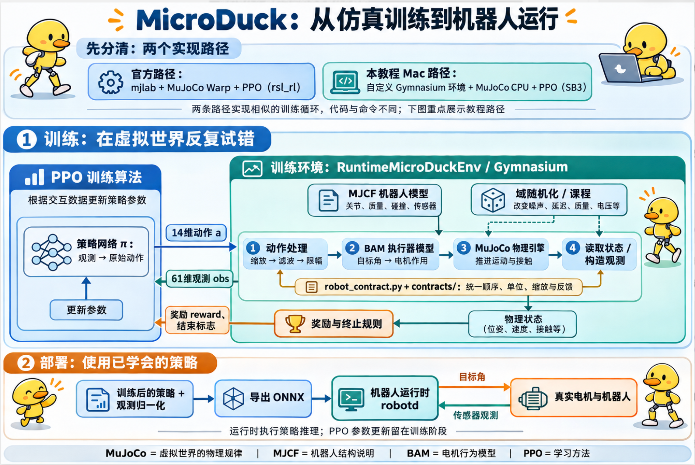
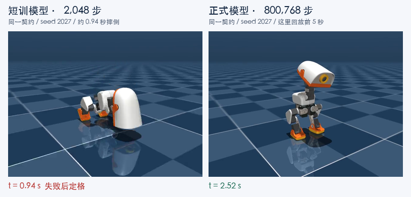
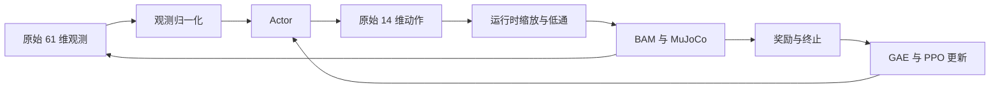
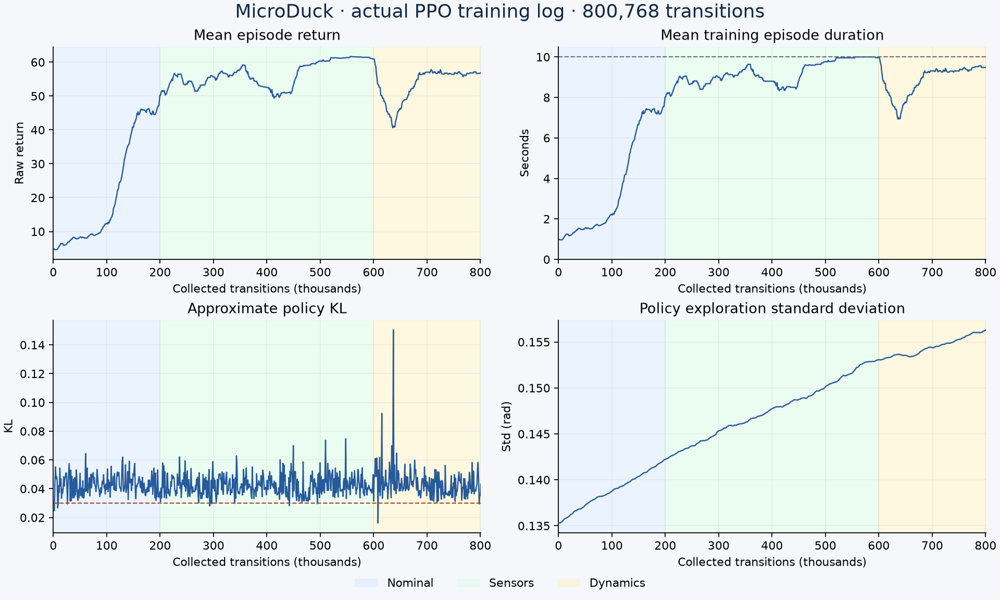
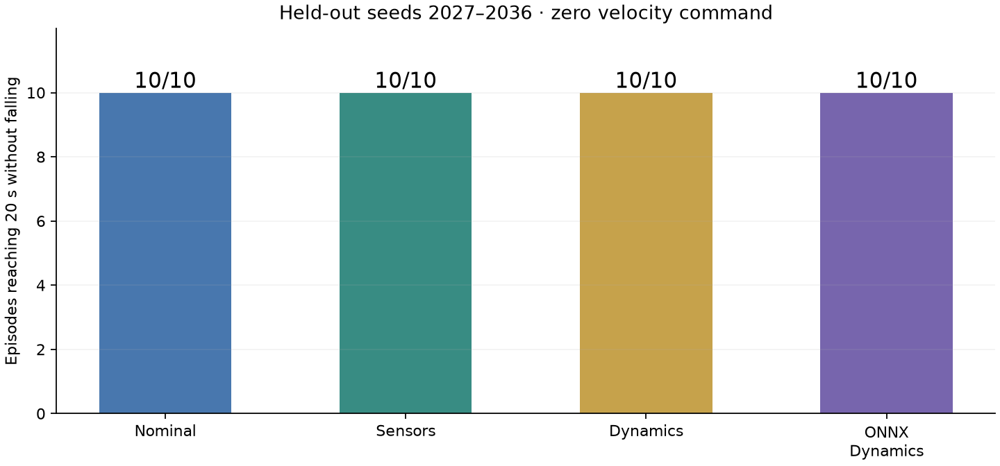
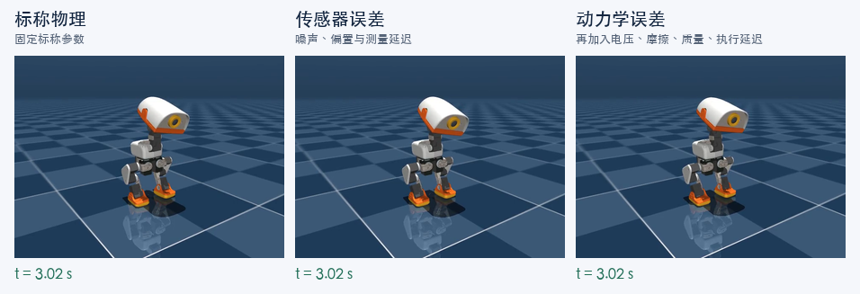
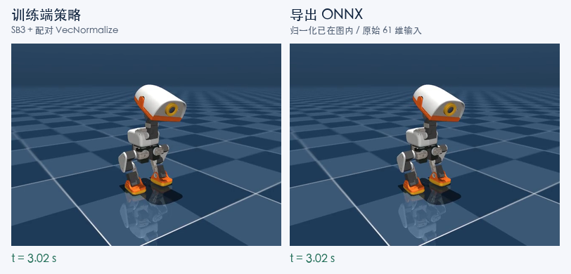

# MicroDuck 在 Mac 上从零训练与验证教程

在 Apple M5 Pro 上搭建原生 MuJoCo 与 BAM 仿真，从随机初始化完成 800768 步 PPO 站立训练，再进行误差分组评估、ONNX 导出与回放。教程保留实际命令、日志结果、失败案例和组合 GIF；实机硬件测试尚未进行。

> 本文同步自 [Space 教程页面](https://chatgpt.com/space/page_943ab998d2748191832e617b17339b41)。Git 仓库提供代码、文档和静态 PNG，未上传模型、训练输出、视频、GIF、离线 HTML 或 ZIP。原始结果包和动态媒体可在 Space 页面中查看，需要对应页面的访问权限；文中的训练结果是历史实验记录，模型需自行训练生成。

本次记录日期为 2026 年 11 月 4 日。教程主线是**按实机控制契约训练站立策略**。正式模型没有加载旧站立权重，也没有使用官方预训练权重；“从零”指随机初始化 PPO。配套源码包中的训练器、环境和契约是必要组成部分，仅克隆官方机器人仓库不能得到这套 Mac 训练入口。

# 组件关系与方案对比

## 从仿真训练到机器人运行



图中重点展示本教程 Mac 路径。训练环境把动作处理、BAM 执行器模型、MuJoCo 物理计算、观测、奖励和终止条件组织起来；PPO 根据交互数据更新策略网络。MJCF 描述机器人结构与物理参数，供 MuJoCo 加载；BAM 描述电机行为，PPO 负责学习。部署时导出策略及观测归一化，由机器人运行时执行推理。图中的实机部分表示部署目标，本教程尚未进行硬件验证。

## 企业方案与本教程和官方方案的组件对比

企业方案列给出按任务选配的产品和框架，不是必须全部安装的统一标准。官方训练路径基于 mjlab、MuJoCo Warp 和 rsl_rl；本教程采用自定义 Gymnasium 环境、MuJoCo CPU 和 SB3。两条路径的训练入口、奖励配置和检查点格式不同。

| 负责什么 | 企业方案中的具体产品或框架 | 本教程 Mac Demo 对应部分 | MicroDuck 官方对应部分 |
| --- | --- | --- | --- |
| 场景与传感器仿真平台 | NVIDIA Isaac Sim，组织场景、渲染和传感器仿真 | 自建 MJCF 室内场景 + MuJoCo 渲染；尚未接入视觉感知 | mjlab 场景与地形配置 + CPU MuJoCo 回放场景 |
| 物理引擎 | Isaac Sim 默认 PhysX，也可选实验性 Newton 后端；独立运动训练可选 MuJoCo / MuJoCo Warp | 原生 MuJoCo CPU，计算动力学、碰撞与接触 | MuJoCo Warp 用于 GPU 训练，原生 MuJoCo 用于 CPU 回放 |
| 组织训练环境 | NVIDIA Isaac Lab 或 mjlab | 自写 Gymnasium 环境 | mjlab |
| 策略训练算法 | rsl_rl、Stable-Baselines3 | SB3 的 PPO | rsl_rl 的 PPO |
| 电机行为建模 | BAM，或经过标定的执行器模型 | BAM M6 XL330 | BAM |
| 机器人模块通信 | ROS 2 | Python 内部调用 | 原生机器人运行系统，不能直接等同于 ROS 2 |
| 路径规划与避障 | Nav2 | 键盘人工控制 | 需要在运动策略之外接入 |
| 实验与模型记录 | MLflow 等 | 本地 JSON、CSV、TensorBoard | 官方训练日志与检查点流程 |
| 机器人数据查看与回放 | Foxglove + MCAP | 仿真窗口、报告、视频 | 运行日志与项目回放工具 |
| 部署策略推理 | ONNX Runtime；适配 NVIDIA 硬件时可选 TensorRT | ONNX Runtime | ONNX 策略 + robotd |

Isaac Sim 是仿真平台；PhysX、Newton 和 MuJoCo 位于物理计算层，负责推进运动、碰撞和接触。Newton 可集成 MuJoCo Warp 求解器，不能简单理解为与 MuJoCo 完全互斥的选择。Isaac Lab 与 mjlab 是训练框架，PPO 是学习算法。Nav2 负责导航规划；接入双足机器人时仍需适配定位、速度接口和可通行性，不能仅安装后就获得越槛能力。本教程的 61 维观测没有障碍物地图或相机输入，键盘驾驶也不等于自主避障。 [Isaac Sim 物理后端说明](https://docs.isaacsim.omniverse.nvidia.com/latest/physics/index.html)、[Newton 后端与限制](https://docs.isaacsim.omniverse.nvidia.com/latest/physics/newton_physics.html)。

表中的自建室内场景和键盘控制属于后续本地扩展；原正式训练记录仍以本教程各步骤中的配置与结果为准，配套下载包不会随本地代码修改自动更新。

产品资料：[Isaac Sim](https://developer.nvidia.com/isaac/sim)、[Isaac Lab](https://developer.nvidia.com/isaac/lab)、[mjlab](https://github.com/mujocolab/mjlab)、[BAM](https://bam.readthedocs.io/en/latest/)、[Nav2](https://docs.nav2.org/rolling/)、[MLflow](https://mlflow.org/docs/latest/ml/tracking/)、[Foxglove](https://foxglove.dev/)、[ONNX Runtime](https://onnxruntime.ai/docs/)。

# 1 先看训练前后的真实回放



*此处为回放静态截图；[查看 Space 中的动态回放](https://chatgpt.com/space/page_943ab998d2748191832e617b17339b41#102bae3c-19bd-40da-a806-b6fd3d3d1cc7)。*

左侧为本次 2048 步短训模型，在约 0.94 秒触发跌倒终止，随后保持最后一帧；右侧为正式模型在相同契约、标称物理、seed 2027、零速度命令下的前 5 秒。两侧时间戳为各自的仿真时间，失败后的定格不代表机器人继续执行了动作。

这是教程整理时用保存的模型重新录制的回放，不是训练过程的实时屏幕录像。后文的完整 20 秒评估结果来自保存的评估 JSON。

本次最终完成：3 组条件各 10 次、每次 20 秒站立评估均达到时限且未触发跌倒；导出的 ONNX 在动力学误差组另外完成 10 次 20 秒回放。这里只证明所测条件下的站立，不代表行走已收敛或实机已验证。

# 2 本机条件与固定版本

| 项目 | 本次实际配置 |
| --- | --- |
| 机器 | MacBook Pro，Apple M5 Pro，48 GB 内存 |
| 系统 | macOS 26.6.2，arm64 |
| Python | 3.12.16 |
| MuJoCo | 3.10.0 |
| PPO | Stable Baselines3 2.9.2 |
| PyTorch | 2.9.1，训练设备 CPU |
| 环境接口 | Gymnasium 1.4.0 |
| 执行器 | BAM M6，XL330，固定 BAM commit |
| GPU 检查 | CUDA=False；MPS=True，但此训练使用 CPU |
| uv | 0.13.7 |

Apple GPU 支持 Metal，不支持官方 MuJoCo Warp 训练需要的 CUDA。本次使用原生 MuJoCo 在 CPU 上采样、CPU PPO 更新网络；CPU 训练不妨碍将策略导出到 ONNX。

在终端检查本机：

```bash
uname -m
sw_vers
```

本次结果为 `arm64` 和 macOS `26.6.2`。安装后再检查库与设备：

```bash
.venv/bin/python - <<'PY'
import mujoco, torch
print("MuJoCo:", mujoco.__version__)
print("PyTorch:", torch.__version__)
print("CUDA:", torch.cuda.is_available())
print("MPS:", torch.backends.mps.is_available())
PY
```

固定的上游版本：

| 用途 | 提交 |
| --- | --- |
| 机器人 MJCF 与官方 CPU BAM 加载器 | `bae39f5900b318f7e87fc485c30a31213cfa14eb` |
| BAM | `62bd8ce12154340be97e06f7f41a0ca8f116d967` |
| 对齐的实机运行时 | `d13be2c1a2f4b1e0b0e499b08b92f870518b1384` |

全部依赖的实际解析版本见 `uv.lock`。教程绘图另使用可选依赖组 `tutorial`，不参与 PPO 控制计算。

# 3 准备项目与安装环境

克隆本仓库后，项目已包含为本教程的 Mac 训练与验证流程专门编写的 `train.py`、`microduck_env.py`、`runtime_env.py`、`robot_contract.py`、`export_runtime.py`，以及配套的 `contracts/`、`scripts/`、`pyproject.toml` 和 `uv.lock`，可直接按后续步骤使用。这些配套代码与官方上游源码是两部分；上游提供机器人模型、BAM 等基础代码，版本固定在前表列出的提交。安装脚本会在你的机器上创建 `.venv`、按 `uv.lock` 安装依赖并下载固定版本的上游模型，无需复制其他机器的虚拟环境。

在新机器上克隆并进入项目目录：

```bash
git clone https://github.com/lynnyan/microduck-mac-lab.git
cd microduck-mac-lab
```

如果克隆时指定了其他目录名，将这条 `cd` 改成实际路径。后文未另作说明的命令均在项目根目录执行。

当前可复现的安装入口是：

```bash
bash scripts/setup.sh
```

脚本依次执行以下核心步骤；首次搭建时也逐项执行过这些等效操作：

```bash
bash scripts/bootstrap_uv.sh
bash scripts/fetch_upstream.sh
./.tools/uv sync --locked --python 3.12
.venv/bin/python verify.py
.venv/bin/python test_runtime_contract.py
```

`bootstrap_uv.sh` 从官方发布地址下载 uv 0.13.7 至项目 `.tools`；`fetch_upstream.sh` 下载并检查固定 Git 提交；`uv sync` 安装到项目 `.venv`。没有修改系统 Python 包或 shell 启动文件。Python 运行时和下载缓存可能位于 uv 的用户目录。

首次手工下载上游模型对应的命令是：

```bash
git clone --no-checkout --filter=blob:none \
  https://github.com/pollen-robotics/microduck_rl.git upstream
git -C upstream checkout bae39f5900b318f7e87fc485c30a31213cfa14eb
```

已有 `upstream/` 时使用 `fetch_upstream.sh` 检查即可，不要重复 clone。安装日志见 [安装检查原始输出（原始结果包内：setup_runtime_final.log）](https://chatgpt.com/space/page_943ab998d2748191832e617b17339b41#6d3b70e9-1947-4d41-b11e-87b450577911)。

# 4 先验证物理与接口

```bash
.venv/bin/python verify.py
.venv/bin/python test_runtime_contract.py
```

本次验证结果：

| 检查 | 实际结果 |
| --- | --- |
| MuJoCo 与 BAM 初始化 | 14 个受控关节 |
| Actor 观测 | 61 维 |
| 策略动作 | 14 维 |
| Gymnasium 与 SB3 接口 | 通过 |
| 同 seed 重置一致性 | 通过 |
| 运行时契约回归 | 10 项通过，0 失败、0 错误 |
| NaN/Inf 动作处理 | 拒绝非有限动作 |
| 时间上限 | 按截断处理，不与跌倒混为一谈 |

10 项回归覆盖：目标缩放和低通的数值案例、观测切片、嘴部排除映射、原始动作反馈、随机化不累积、reset 确定性、课程不改变控制语义、执行延迟单位、Gym 接口、旧配方模型导出拒绝和首次续训课程计数；其中部分检查合并在同一个测试函数中。

**一个真实失败案例：**初次验证曾把“固定 HOME 应站立 3 秒”当成通过条件，实际零动作基线约 1.24 秒倒下。HOME 是参考姿态，不是平衡控制器，因此最终检查如实记录这条基线，并验证跌倒重置和后续学习策略，而不把它误报为稳定站立。

原始数据见 [基础验证 JSON（原始结果包内：verification.json）](https://chatgpt.com/space/page_943ab998d2748191832e617b17339b41#0af22cec-5c24-4f97-9d58-34cf8b1ae564)、[契约验证 JSON（原始结果包内：runtime_contract_tests.json）](https://chatgpt.com/space/page_943ab998d2748191832e617b17339b41#0af22cec-5c24-4f97-9d58-34cf8b1ae564) 和 [回归测试输出（原始结果包内：runtime_contract_tests.log）](https://chatgpt.com/space/page_943ab998d2748191832e617b17339b41#0af22cec-5c24-4f97-9d58-34cf8b1ae564)。

# 5 明确训练和实机共同遵循的契约

```bash
cat contracts/runtime_default_v1.json
```

这份文件来自指定运行时源码版本的默认配置，而不是猜测真实机器的参数。

| 项目 | 契约 |
| --- | --- |
| 网络输入输出 | float32 `obs[1,61]` → `actions[1,14]` |
| 关节顺序 | 左腿 5、颈头 4、右腿 5；嘴部不参与策略 |
| 控制频率 | 50 Hz，每个动作跨 4 个 5 ms 物理子步 |
| 站立槽位 | action scale=1.0，舵机 firmware gain=160 |
| 行走槽位 | action scale=0.9，舵机 firmware gain=200 |
| 低通 | 头部 alpha=0.5，腿部 alpha=0.7；首帧不滤波 |
| 上一次动作 | 原始网络输出，位于缩放、低通和目标裁剪之前 |
| 归一化 | 训练时 VecNormalize；导出时折叠进 ONNX |

观测切片：

| 切片 | 内容 |
| --- | --- |
| `0:3` | 机体角速度 |
| `3:6` | 机体坐标系的投影重力方向 |
| `6:20` | 相对 HOME 的 14 个关节位置 |
| `20:34` | 14 个关节速度 |
| `34:48` | 上一次原始策略动作 |
| `48:51` | 前进、侧移、转向命令 |
| `51:55` | 4 个头部姿态命令 |
| `55:61` | 6 个身体姿态命令槽位 |

本次站立训练使用零速度命令；头部只采样小幅偏移，身体命令保持零。不能把保留的命令槽位解释为已经学会完整身体姿态控制。

PPO 用当前 Actor 与仿真交互，保存动作、奖励和旧概率；Critic 提供价值估计，GAE 计算优势，PPO Clip 更新网络。本次本机版使用两个 128×128 的 MLP，PPO 初始学习率 0.0003，gamma=0.99，GAE lambda=0.95，clip=0.2，最多 5 个学习 epoch，并按 KL 提前停止。它遵循相同控制契约，但不声称逐项复刻官方 mjlab 的完整训练配方。



# 6 用 2048 步短训检查完整链路

以下为本次短训使用的命令：

```bash
.venv/bin/python train.py --task stand \
  --envs 2 --n-steps 128 --batch-size 128 \
  --timesteps 2048 --dr-profile nominal \
  --output outputs/runtime_smoke
```

结果：完成 2048 条 transition，正常保存 `model.zip` 和 `vecnormalize.pkl`，训练状态为 `complete`。这一步检查“能采样、能反向传播、能保存和加载”，不检查技能是否收敛。

短训模型也执行过导出和回放：

```bash
.venv/bin/python export_runtime.py --run outputs/runtime_smoke \
  --output outputs/runtime_smoke/export

.venv/bin/python play.py --onnx outputs/runtime_smoke/export/policy.onnx \
  --seconds 1 --episodes 1 --headless \
  --report outputs/runtime_smoke/onnx_eval.json
```

导出在 364 组输入上通过数值检查，最大误差约 `2.98e-7`；但策略在约 0.94 秒跌倒。**导出正确和行为合格是两件事。** 本教程开头的 GIF 展示了这个失败结果。

历史输出目录已存在，直接重跑会被拒绝以防覆盖。复现实验时，将同一组命令中的 run 路径统一改成新目录，例如 `outputs/reproduce_smoke`。

# 7 从随机初始化完成正式训练

本次正式执行的命令为：

```bash
bash scripts/train_macos.sh --task stand --envs 4 \
  --timesteps 800000 \
  --nominal-steps 200000 --sensor-steps 600000 \
  --output outputs/runtime_stand_v1
```

默认 `--recipe runtime`、`--dr-profile curriculum`，且没有 `--resume`，因此从随机权重开始。旧版 0.35 动作缩放的模型没有用于初始化。

| 训练设置 | 值 |
| --- | --- |
| 环境数 | 4 |
| 每个环境每轮采样 | 256 步 |
| 每轮 transition | 4×256=1024 |
| mini-batch | 256 |
| seed | 42 |
| 训练回合最长时长 | 10 秒 |
| checkpoint 周期 | 约每 20000 条 transition |

课程只改变误差分布，始终保持动作缩放、滤波、HOME、关节顺序和原始动作反馈一致：

| 累计 transition | 阶段 | 主要设置 |
| --- | --- | --- |
| 0 到 200000 | nominal | 固定标称物理，reset 有小幅关节扰动 |
| 200000 到 600000 | sensors | 编码器偏置、IMU 安装误差、噪声、测量延迟，半强度 |
| 600000 之后 | dynamics | 全强度传感误差，再加电压、摩擦、质量惯量、质心和执行延迟 |

动力学阶段的执行延迟为 **3 到 6 个物理子步，即 15 到 30 ms**，不是 3 到 6 个控制周期。电压范围 6.5 到 8.2 V，BAM 摩擦幅度 0.9 到 1.1 倍，躯干质量与惯量同时缩放 0.95 到 1.05 倍，质心 ±3 mm，足地摩擦 0.7 到 1.3。每次 reset 都先恢复基线，再采样，避免误差累积。

实际训练结束记录：

```json
{
  "timesteps": 800768,
  "interrupted": false,
  "status": "complete"
}
```

为什么多出 768 步：PPO 收集完整 rollout，不能在一批中间精确停在 800000；782×1024=800768。

保存结果包括模型、归一化统计、配置快照、契约快照、周期 checkpoint、TensorBoard 事件和 CSV。完整模型与配对归一化分别为 `outputs/runtime_stand_v1/model.zip` 和 `outputs/runtime_stand_v1/vecnormalize.pkl`。

# 8 读取训练曲线而不只看最终奖励



蓝、绿、黄底色分别为标称、传感器和动力学阶段。图直接来自本次 `progress.csv`，没有补造或平滑掉下降段。

## 8.1 先读坐标和统计口径

横轴是累计采集的 transition，单位为千；例如 600 表示 60 万条“观测、动作、奖励、下一帧观测”记录。4 个环境的采样合并计数，因此它既不是单台机器人连续运行的时长，也不是神经网络更新次数。每轮合计采样 1024 条 transition，再用这一批数据做 PPO 更新。

蓝、绿、黄背景对应三种训练分布。20 万步后逐回合引入传感器误差，60 万步后引入完整动力学误差；阶段在环境 reset 时生效，曲线不会在分界线处整齐地同时跳变。上方两条曲线是最近最多 100 个已结束训练回合的滑动均值，早期不足 100 回合时使用已有回合，因此带有统计滞后；它们不是每一个物理时刻的瞬时读数。

| 图中位置与英文标题 | 日志字段 | 直观含义 | 怎样判断 |
| --- | --- | --- | --- |
| 左上 Mean episode return | `rollout/ep_rew_mean` | 最近回合累计获得了多少奖励 | 同一奖励配方下看趋势，并结合时长与独立评估 |
| 右上 Mean training episode duration | `rollout/ep_len_mean × 0.02` | 一次训练回合平均持续多久，图中单位为秒 | 本次上限 10 秒，越接近上限通常表示越少提前跌倒 |
| 左下 Approximate policy KL | `train/approx_kl` | 一轮更新把动作概率分布改动了多少 | 关注大幅尖峰及其是否伴随行为退化，不要求降到零 |
| 右下 Policy exploration standard deviation | `train/std` | 训练采样动作时随机探索的幅度 | 结合任务表现判断，不要求持续下降 |

奖励与时长的统计口径见 [SB3 日志说明](https://stable-baselines3.readthedocs.io/en/master/common/logger.html)。本次 KL、Std 和提前停止的具体含义，以安装的 SB3 2.9.2 PPO 实现和本项目配置为准。

## 8.2 左上曲线是平均回合回报

一个 episode 从 reset 开始，到跌倒或达到时限结束；回合回报是这一回合每一步奖励的相加，即 `R = r₀ + r₁ + … + rₜ`。图中显示的是原始环境奖励的回合总和，不是每一步奖励，也不是折扣后的价值预测。虽然优化时使用了奖励归一化，Monitor 在归一化外层之前记录的原始回报用于这张图。

MicroDuck 的奖励包含存活、身体直立、零速度与转向跟踪、接近参考姿态、头部跟踪；动作突变、过快关节运动、接近关节极限和跌倒会扣分。机器人站得更久会累积更多正奖励，站得更稳也可能提高每步奖励。因此回报上升可能同时来自“少跌倒”和“同样时长下姿态更好”，不能只看这一条线区分两者。

本次均值从 4.7383 升至 56.9250，但这不是“准确率从 4.7% 升至 56.9%”。奖励大小由本项目权重与回合时限决定，修改配方后不能直接比较两个绝对数值。

## 8.3 右上曲线是平均训练回合时长

日志原值是控制步数，绘图时乘以控制周期 0.02 秒。比如 250 步对应 5 秒，500 步对应本次最长训练时限 10 秒；灰色虚线表示这条 10 秒上限。跌倒会提前结束回合，达到 10 秒则属于时间截断。

本次平均时长从 0.9800 秒增至 9.4952 秒，说明最近训练回合多数能维持较长时间。9.4952 秒仍是均值，可能包含提前跌倒的回合，不能推导出每一回合都成功。接近 10 秒也不证明头部跟踪、动作平滑等指标已最优，仍要看回报分项和独立验证。

## 8.4 左下曲线中的 KL 散度是什么

策略不是只给出一个固定动作，而是给出“当前观测下各种动作的概率分布”。KL 散度衡量两个概率分布的差异。在 PPO 中，比较的是**采集这批数据的旧策略**与**正在更新的新策略**：同样看到机器人向左倾斜，新旧策略会以多大概率选择不同的纠正动作。

用旧策略分布 P、新策略分布 Q 表示，定义可写为：

```text
D_KL(P || Q) = E[a ~ P] [ ln(P(a) / Q(a)) ]
```

KL 为零表示两个分布相同；数值越大，分布改动越明显。它没有角度或距离单位，使用自然对数时通常记为 nats，也不是百分比。KL 一般不对称，即 `D_KL(P || Q)` 与 `D_KL(Q || P)` 不一定相等，因此严格来说不是通常意义上的距离。

一个便于理解的例子：假设只有一个关节，两种策略都是标准差 0.1 的高斯分布；旧均值为 0，新均值为 0.01，则该维的 KL 为 0.005。若新均值改为 0.1，同样的标准差下 KL 就是 0.5。这个例子只展示“均值移动相对探索范围越大，分布变化越大”，不是本次日志的测量结果。本次动作有 14 维，联合分布的 KL 综合了各维的变化，不能将某个 KL 值直接换算成一个关节转动多少度。

图中记录的是采样近似值。SB3 对本批观测与旧策略采样动作计算以下估计，避免为每个状态显式积分整个动作分布：

```text
log_ratio = log π_new(a | obs) - log π_old(a | obs)
approx_kl = mean(exp(log_ratio) - 1 - log_ratio)
```

它估计的是在采样状态下，旧动作分布相对新分布的平均差异；不是新模型与真实机器人之间的误差，也不是相邻两个关节角的差值。日志值来自当前更新中最后执行到的优化 epoch 内、已检查 mini-batch 的估计均值，并非全训练过程累计 KL。采样和优化会产生波动，曲线无需单调下降。[SB3 PPO 实现](https://stable-baselines3.readthedocs.io/en/master/_modules/stable_baselines3/ppo/ppo.html)

**为什么 PPO 要看它？** PPO 用旧策略采样的数据更新新策略。如果一次改动太大，旧数据就难以代表新策略的行为，原本会站立的策略也可能被一次激进更新破坏。PPO 的 Clip 通过限制概率比对目标函数的收益来抑制大更新，但不是对 KL 的硬约束。本次 `clip_range=0.2` 也不表示“关节动作最多变化 20%”。

本次 `target_kl=0.03`，图中的棕色虚线表示这个参考目标；SB3 检查到某个 mini-batch 的近似 KL 超过 `1.5 × 0.03 = 0.045` 时，会停止这一轮剩余优化，再继续采样和训练，**不是终止整个训练任务**。因此虚线不是曲线绝不能越过的上限：先前 mini-batch 的更新已经发生，之后才检测到超限，日志平均值也可能高于 0.045。

本次最大已记录 KL 约为 0.1504，出现在累计 636928 步附近；最后一个记录值约为 0.0433。这说明动力学阶段出现过较大的策略分布改动，需要结合回报、时长和评估审视。仅凭一个尖峰不能判定训练失败，也不能因为程序有提前停止就认为每次更新都足够温和。持续接近零也未必好：如果回报和时长同时停滞，可能意味着策略更新太小。

## 8.5 右下曲线是探索动作的标准差

本次 Actor 使用对角高斯分布，可以把训练采样理解为 `action = μ(obs) + σ × ε`，其中 `ε` 来自标准正态分布。网络学习“更倾向输出什么动作”的均值 μ，同时学习“尝试偏离均值多少”的标准差 σ。

本项目未启用 gSDE；SB3 的 `train/std` 在这里是 14 个动作维度的 `exp(log_std)` 的平均值，表示采样分布的探索幅度。它不是观测噪声大小、Critic 预测误差、硬件关节角的实测标准差，也不等于最终执行器目标的抖动：动作还要经过限幅、缩放、低通和执行器动力学。

本次初始化 `log_std=-2`，因此初始标准差约为 `exp(-2)=0.1353`；日志末值约为 0.1563，探索幅度略有增加。训练包含熵奖励，且后半程误差分布更复杂，标准差没有必须下降的要求；这条线本身不能证明增加探索的具体原因。

确定性评估和本次 ONNX 导出使用策略均值，不再添加这里的高斯探索采样。因此“训练 Std 增大”和“确定性回放仍能稳定站立”可以同时成立。

## 8.6 把四条曲线放在一起判断

本次可以分三段阅读：前期回报和时长整体上升，对应学习基本站立；传感器阶段观察策略在有测量误差时是否保持表现；进入动力学阶段后，回报与时长下降、KL 出现尖峰，随后表现恢复，说明策略经历了对更难分布的适应过程。这里的“适应”是结合课程安排和曲线走势的解释，最终是否可用仍由独立回放验证。

| 同时观察到的现象 | 可以怎样理解与排查 |
| --- | --- |
| 回报、时长持续上升，KL 有波动 | 通常表示正在学习；继续关注不同误差组的独立评估 |
| 阶段切换后回报和时长下降，随后恢复 | 可能是新误差提高难度，检查恢复速度及失败回合 |
| KL 反复出现大尖峰，回报与时长持续退化 | 检查学习率、每批优化次数、优势与奖励尺度，必要时减小更新强度 |
| KL 很小，回报和时长也长期不动 | 检查更新是否太弱、奖励是否提供有效信号，不能只追求更小 KL |
| 时长接近 10 秒，但回报或姿态仍不理想 | 生存接近时限不等于控制精度足够，应看奖励分项与回放 |

本次验收依据仍是后文三组各 10 次、每次 20 秒的独立站立评估，以及导出 ONNX 的再验证。训练曲线用于解释学习过程，不代替技能验收。

开始加入动力学随机化后，回合奖励与平均回合时长明显下降，随后恢复。这表明新误差分布提高了难度；不能仅凭这个拐点就判断训练崩溃，也不能因为总奖励最终上升就跳过独立评估。

| 日志指标 | 首条记录 | 最后一条记录 |
| --- | --- | --- |
| 累计 transition | 1024 | 800768 |
| 平均回合原始回报 | 4.7383 | 56.9250 |
| 平均训练回合时长 | 0.9800 秒 | 9.4952 秒 |
| 训练迭代 | 1 | 782 |

日志最后报告的学习循环耗时为 175 秒、采样与更新总体速度约 4562 transition/s；这是该次运行的日志计时，不含首次依赖下载，也不是其他电脑的性能保证。训练回合最长 10 秒，而后文独立评估每次 20 秒，两种时长不能混用。

查看 TensorBoard：

```bash
bash scripts/tensorboard.sh
```

在浏览器访问 `http://127.0.0.1:6006`，按 Ctrl+C 停止。该入口已经验证可返回 HTTP 200，测试服务随后停止，没有持续占用端口。

原始曲线数据见 [progress.csv（原始结果包内：progress.csv）](https://chatgpt.com/space/page_943ab998d2748191832e617b17339b41#54bc56a2-2d02-4f80-9cf3-e9ce259c39a4)，正式训练输出见 [runtime_stand_v1.log（原始结果包内：runtime_stand_v1.log）](https://chatgpt.com/space/page_943ab998d2748191832e617b17339b41#54bc56a2-2d02-4f80-9cf3-e9ce259c39a4)。

# 9 对三种误差条件分别验证

固定模型、冻结归一化统计、使用确定性动作，分别执行：

```bash
.venv/bin/python play.py --run outputs/runtime_stand_v1 \
  --dr-profile nominal --seconds 20 --episodes 10 --headless \
  --report outputs/runtime_stand_v1/eval_nominal.json

.venv/bin/python play.py --run outputs/runtime_stand_v1 \
  --dr-profile sensors --seconds 20 --episodes 10 --headless \
  --report outputs/runtime_stand_v1/eval_sensors.json

.venv/bin/python play.py --run outputs/runtime_stand_v1 \
  --dr-profile dynamics --seconds 20 --episodes 10 --headless \
  --report outputs/runtime_stand_v1/eval_dynamics.json
```

默认 seeds 为 2027 到 2036，与训练 seed=42 分开；速度命令和头部命令都为零。

| 评估条件 | 回合数 | 每回合时限 | 达到时限且未跌倒 | 平面速度 RMSE 均值 |
| --- | --- | --- | --- | --- |
| 标称物理 | 10 | 20 秒 | 10/10 | 0.00609 m/s |
| 传感器误差 | 10 | 20 秒 | 10/10 | 0.00921 m/s |
| 动力学误差 | 10 | 20 秒 | 10/10 | 0.00575 m/s |

站立命令为零，所以这里的速度 RMSE 表示残余运动，不是行走速度跟踪成绩。“未跌倒”按环境的高度与倾角终止条件判定，不是对姿态精度的独立认证。10/10 是这 10 个样本的结果，不代表所有参数、地形或真实机器人都不会倒。



下面的组合 GIF 用同一个正式模型、同一个 seed 2027，展示三种条件各自前 6 秒。它补充视觉观察，不替代上面的 20 秒逐回合统计。



*此处为回放静态截图；[查看 Space 中的动态回放](https://chatgpt.com/space/page_943ab998d2748191832e617b17339b41#881d537b-ad8c-467a-a1d5-9cca6c3bbe90)。*

逐回合数据：[标称（原始结果包内：eval_nominal.json）](https://chatgpt.com/space/page_943ab998d2748191832e617b17339b41#03b7747c-c271-4a19-80f1-348eb2315a89)、[传感器误差（原始结果包内：eval_sensors.json）](https://chatgpt.com/space/page_943ab998d2748191832e617b17339b41#03b7747c-c271-4a19-80f1-348eb2315a89)、[动力学误差（原始结果包内：eval_dynamics.json）](https://chatgpt.com/space/page_943ab998d2748191832e617b17339b41#03b7747c-c271-4a19-80f1-348eb2315a89)。

# 10 导出包含归一化的 ONNX

本次执行：

```bash
bash scripts/export_runtime.sh --run outputs/runtime_stand_v1 \
  --output outputs/runtime_stand_v1/export
```

导出器把观测均值、方差、epsilon 和输入裁剪、Actor、策略内部输出限幅放进 ONNX；输出仍为运行时要接收的原始动作。外部控制器继续应用契约中的 scale 和低通，不能再重复归一化、缩放或滤波。

| 检查 | 本次结果 |
| --- | --- |
| 输入 | 名称 `obs`，形状 `[1,61]`，float32 |
| 输出 | 名称 `actions`，形状 `[1,14]`，float32 |
| 对齐数据 | 三种误差配置各 100 帧实际观测，加 64 组额外输入，共 364 组 |
| 比较基准 | SB3 确定性推理，使用配对 VecNormalize |
| 最大绝对动作误差 | `1.0728836059570312e-6` |
| 允许阈值 | `1e-4` |
| 结果 | passed |

导出模型 SHA256：

```text
c52313fd43e88a24610a5154e177e05d2f4fefd53091f4822a2a0a3818b56fdc
```

可自行检查：

```bash
shasum -a 256 outputs/runtime_stand_v1/export/policy.onnx
cat outputs/runtime_stand_v1/export/validation.json
```

导出目录还包含 `contract.json`、`deployment_requirements.json`、官方 schema 2 的本地 `manifest.json` 和 `replay_inputs.npz`。这些产物尚未上传到 Hub，也没有安装到实机。

# 11 重新加载 ONNX 再验证

本次还单独执行了导出模型的动力学误差回放：

```bash
bash scripts/view.sh \
  --onnx outputs/runtime_stand_v1/export/policy.onnx \
  --dr-profile dynamics --seconds 20 --episodes 10 --headless \
  --report outputs/runtime_stand_v1/eval_onnx_dynamics.json
```

结果为 10/10 次达到 20 秒且未跌倒。数据见 [ONNX 回放评估 JSON（原始结果包内：eval_onnx_dynamics.json）](https://chatgpt.com/space/page_943ab998d2748191832e617b17339b41#dcee2bd8-be68-4230-8b7f-46fd91d56b4a)。



*此处为回放静态截图；[查看 Space 中的动态回放](https://chatgpt.com/space/page_943ab998d2748191832e617b17339b41#60523507-f1ae-42fc-ad37-708dde7c3d5c)。*

左侧为重新加载的 SB3 checkpoint 与配对归一化，右侧为 ONNX，均使用 seed 2027、标称物理和零速度命令。这是 6 秒视觉对照；精确数值一致性以 364 组输入的对齐检查为依据，不能仅凭两个画面相似就判定导出正确。

# 12 打开窗口与查看原始视频

查看新模型：

```bash
bash scripts/view.sh \
  --onnx outputs/runtime_stand_v1/export/policy.onnx \
  --dr-profile dynamics --seconds 20 --episodes 1
```

Mac 的普通回放窗口由 `mjpython` 启动；后续新增的 `--keyboard` 驾驶窗口使用普通 Python 主线程处理按键，`view.sh` 已区分这两种启动方式。`--headless` 用于不渲染的评估；`--video` 用于离屏录制 MP4。

下列链接定位到 Space 页面中的原始视频附件，需要页面访问权限。本仓库不托管视频；本地生成的 HTML 版可直接播放相应 MP4：

- [本次原有的 5 秒候选预览](https://chatgpt.com/space/page_943ab998d2748191832e617b17339b41#6bf0d0d5-7681-4071-9b78-7c161d9d0173)

- [2048 步短训失败回放](https://chatgpt.com/space/page_943ab998d2748191832e617b17339b41#53f9f1d9-f078-461a-a544-b0ecc1c7b616)

- [标称物理 6 秒回放](https://chatgpt.com/space/page_943ab998d2748191832e617b17339b41#357ff5f0-1bd9-4353-9743-8c49ce017dca)

- [传感器误差 6 秒回放](https://chatgpt.com/space/page_943ab998d2748191832e617b17339b41#070e7512-e5b0-48f6-b905-762ab237d114)

- [动力学误差 6 秒回放](https://chatgpt.com/space/page_943ab998d2748191832e617b17339b41#8b7d1812-5354-4408-b05d-25ef73245785)

- [重新加载 checkpoint 的 6 秒回放](https://chatgpt.com/space/page_943ab998d2748191832e617b17339b41#b0f3326f-5a38-4c7d-b88c-ef74a192377d)

这些视频均由 MuJoCo 渲染，没有使用生成式图像补造动作。组合 GIF 采用 10 fps，原始视频保留 50 fps。

# 13 验证继续训练和行走入口

## 继续训练的实际命令

```bash
.venv/bin/python train.py --task stand \
  --resume outputs/runtime_smoke \
  --envs 2 --n-steps 128 --batch-size 128 \
  --dr-profile sensors --timesteps 512 \
  --output outputs/runtime_resume_smoke
```

累计步数从 2048 增至 2560，状态为 complete，说明 checkpoint、优化器和配对归一化可恢复。自动课程的首次 rollout 已有专门回归检查，使用模型累计步数而不是回调尚未更新的零计数。

## 行走入口的实际短训

```bash
bash scripts/train_runtime.sh --task walk --envs 2 \
  --timesteps 1024 --dr-profile nominal \
  --output outputs/runtime_walk_smoke

bash scripts/export_runtime.sh --run outputs/runtime_walk_smoke \
  --output outputs/runtime_walk_smoke/export

bash scripts/view.sh --onnx outputs/runtime_walk_smoke/export/policy.onnx \
  --command 0.2 0 0 --seconds 0.1 --episodes 1 --headless \
  --report outputs/runtime_walk_smoke/onnx_interface.json
```

行走入口完成 1024 步短训，导出对齐误差约 `1.19e-7`；这只检查 walk 槽位的 scale=0.9、gain=200 和模型接口。**0.1 秒回放不构成行走能力验收，本次没有交付收敛的契约版行走策略。**

## 后续可选的分目录阶段训练

```bash
bash scripts/train_runtime_staged.sh outputs/my_staged_stand
```

该脚本依次保存标称、传感器、动力学三段模型，方便比较和回退；它不是本次 800768 步正式运行所使用的入口。本次正式运行用的是第 7 节的一次连续课程训练。

# 14 复现本教程中的视频和 GIF

安装可选绘图依赖：

```bash
./.tools/uv sync --locked --group tutorial --python 3.12
mkdir -p tutorial/assets tutorial/evidence
```

以下为本次制作教程素材时实际执行的录像命令，模型保持冻结，不重新训练：

```bash
bash scripts/view.sh --onnx outputs/runtime_smoke/export/policy.onnx \
  --dr-profile nominal --seconds 5 --episodes 1 --seed 2027 \
  --video tutorial/assets/early_2048.mp4 \
  --report tutorial/evidence/early_2048_replay.json

bash scripts/view.sh --onnx outputs/runtime_stand_v1/export/policy.onnx \
  --dr-profile nominal --seconds 6 --episodes 1 --seed 2027 \
  --video tutorial/assets/nominal.mp4 \
  --report tutorial/evidence/nominal_replay.json

bash scripts/view.sh --onnx outputs/runtime_stand_v1/export/policy.onnx \
  --dr-profile sensors --seconds 6 --episodes 1 --seed 2027 \
  --video tutorial/assets/sensors.mp4 \
  --report tutorial/evidence/sensors_replay.json

bash scripts/view.sh --onnx outputs/runtime_stand_v1/export/policy.onnx \
  --dr-profile dynamics --seconds 6 --episodes 1 --seed 2027 \
  --video tutorial/assets/dynamics.mp4 \
  --report tutorial/evidence/dynamics_replay.json

bash scripts/view.sh --run outputs/runtime_stand_v1 \
  --dr-profile nominal --seconds 6 --episodes 1 --seed 2027 \
  --video tutorial/assets/checkpoint.mp4 \
  --report tutorial/evidence/checkpoint_replay.json

cp outputs/runtime_stand_v1/preview.mp4 tutorial/assets/original_preview.mp4
.venv/bin/python scripts/build_tutorial_media.py
.venv/bin/python scripts/build_tutorial.py
```

组合脚本读取这些真实视频，添加标签和时间戳，生成 3 个循环 GIF，并从原始 CSV/JSON 绘制训练与评估图。短训模型失败后，GIF 明确标记“失败后定格”，不会接入另一次成功回合来掩盖失败。媒体参数和校验值见 [media_manifest.json（原始结果包内：media_manifest.json）](https://chatgpt.com/space/page_943ab998d2748191832e617b17339b41#14ece290-35ea-4502-bdea-760742d5fd53)。

`build_tutorial.py` 汇集原始结果、生成 `tutorial/index.html`，并打包完整离线教程、训练源码和原始结果三个 ZIP。双击 `tutorial/index.html` 即可离线查看图文和播放 MP4，无需持续运行网页服务。

# 15 文件索引和可复现边界

| 文件或目录 | 用途 |
| --- | --- |
| `train.py`、`runtime_env.py` | 训练、课程和物理误差 |
| `robot_contract.py`、`contracts/` | 观测、缩放、低通和执行器契约 |
| `export_runtime.py` | 包含归一化的 ONNX 导出与对齐检查 |
| `play.py` | checkpoint/ONNX 回放、评估、录像 |
| `test_runtime_contract.py` | 契约与环境回归 |
| `outputs/runtime_stand_v1/` | 正式模型、归一化、配置和验证结果 |
| `tutorial/assets/` | GIF、PNG 和 MP4 |
| `tutorial/evidence/` | 本教程使用的日志、CSV、JSON 和媒体清单 |
| `tutorial/index.html` | 可离线查看并播放视频的图文版 |

本次正式模型的全部逐回合结果汇总在 [results.json（原始结果包内：results.json）](https://chatgpt.com/space/page_943ab998d2748191832e617b17339b41#bb087123-c689-47e5-9f33-590450f373af)。在新机器上复现，首先克隆本仓库、安装锁定依赖，再使用新的输出目录训练；同一 seed 也不保证不同平台的浮点和接触求解逐位一致，应比较多个种子的统计与回放。

实机接入前仍要核对真实固件、robotd tuning、关节零位、IMU 坐标和时序。`manifest.json` 不会自动替步态设置 scale、滤波和 gain；需要对照 `deployment_requirements.json`。本次没有连接真实舵机、运行完整 Rust daemon、发布模型或执行硬件测试。

## 相关原始资料

- [MicroDuck 官方训练源码](https://github.com/pollen-robotics/microduck_rl/tree/bae39f5900b318f7e87fc485c30a31213cfa14eb)

- [实机观测契约](https://github.com/pollen-robotics/microduck/blob/d13be2c1a2f4b1e0b0e499b08b92f870518b1384/duck-control/src/obs.rs)

- [实机缩放 滤波与增益](https://github.com/pollen-robotics/microduck/blob/d13be2c1a2f4b1e0b0e499b08b92f870518b1384/robotd/src/control.rs)

- [BAM 固定版本](https://github.com/Rhoban/bam/tree/62bd8ce12154340be97e06f7f41a0ca8f116d967)
