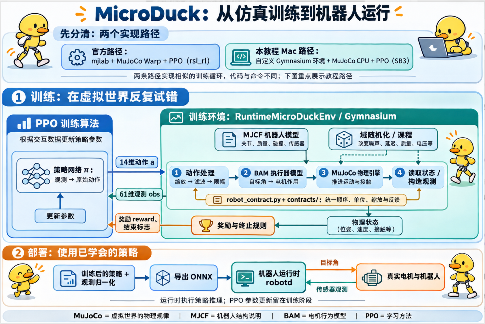

# 组件关系与方案对比

## 从仿真训练到机器人运行

图中重点展示本教程 Mac 路径。训练环境把动作处理、BAM 执行器模型、MuJoCo 物理计算、观测、奖励和终止条件组织起来；PPO 根据交互数据更新策略网络。MJCF 描述机器人结构与物理参数，供 MuJoCo 加载；BAM 描述电机行为，PPO 负责学习。部署时导出策略及观测归一化，由机器人运行时执行推理。图中的实机部分表示部署目标，本教程尚未进行硬件验证。

## 企业方案与本教程和官方方案的组件对比

企业方案列给出按任务选配的产品和框架，不是必须全部安装的统一标准。官方训练路径基于 mjlab、MuJoCo Warp 和 rsl_rl；本教程采用自定义 Gymnasium 环境、MuJoCo CPU 和 SB3。两条路径的训练入口、奖励配置和检查点格式不同。

| 负责什么 | 企业方案中的具体产品或框架 | 本教程 Mac Demo 对应部分 | MicroDuck 官方对应部分 |
| --- | --- | --- | --- |
| 场景与传感器仿真平台 | NVIDIA Isaac Sim，组织场景、渲染和传感器仿真 | 自建 MJCF 室内场景 + MuJoCo 渲染；尚未接入视觉感知 | mjlab 场景与地形配置 + CPU MuJoCo 回放场景 |
| 物理引擎 | Isaac Sim 默认 PhysX，也可选实验性 Newton 后端；独立运动训练可选 MuJoCo / MuJoCo Warp | 原生 MuJoCo CPU，计算动力学、碰撞与接触 | MuJoCo Warp 用于 GPU 训练，原生 MuJoCo 用于 CPU 回放 |
| 组织训练环境 | NVIDIA Isaac Lab 或 mjlab | 自写 Gymnasium 环境 | mjlab |
| 策略训练算法 | rsl_rl、Stable-Baselines3 | SB3 的 PPO | rsl_rl 的 PPO |
| 电机行为建模 | BAM，或经过标定的执行器模型 | BAM M6 XL330 | BAM |
| 机器人模块通信 | ROS 2 | Python 内部调用 | 原生机器人运行系统，不能直接等同于 ROS 2 |
| 路径规划与避障 | Nav2 | 键盘人工控制 | 需要在运动策略之外接入 |
| 实验与模型记录 | MLflow 等 | 本地 JSON、CSV、TensorBoard | 官方训练日志与检查点流程 |
| 机器人数据查看与回放 | Foxglove + MCAP | 仿真窗口、报告、视频 | 运行日志与项目回放工具 |
| 部署策略推理 | ONNX Runtime；适配 NVIDIA 硬件时可选 TensorRT | ONNX Runtime | ONNX 策略 + robotd |

Isaac Sim 是仿真平台；PhysX、Newton 和 MuJoCo 位于物理计算层，负责推进运动、碰撞和接触。Newton 可集成 MuJoCo Warp 求解器，不能简单理解为与 MuJoCo 完全互斥的选择。Isaac Lab 与 mjlab 是训练框架，PPO 是学习算法。Nav2 负责导航规划；接入双足机器人时仍需适配定位、速度接口和可通行性，不能仅安装后就获得越槛能力。本教程的 61 维观测没有障碍物地图或相机输入，键盘驾驶也不等于自主避障。 [Isaac Sim 物理后端说明](https://docs.isaacsim.omniverse.nvidia.com/latest/physics/index.html)、[Newton 后端与限制](https://docs.isaacsim.omniverse.nvidia.com/latest/physics/newton_physics.html)。

表中的自建室内场景和键盘控制属于后续本地扩展；原正式训练记录仍以本教程各步骤中的配置与结果为准，配套下载包不会随本地代码修改自动更新。

产品资料：[Isaac Sim](https://developer.nvidia.com/isaac/sim)、[Isaac Lab](https://developer.nvidia.com/isaac/lab)、[mjlab](https://github.com/mujocolab/mjlab)、[BAM](https://bam.readthedocs.io/en/latest/)、[Nav2](https://docs.nav2.org/rolling/)、[MLflow](https://mlflow.org/docs/latest/ml/tracking/)、[Foxglove](https://foxglove.dev/)、[ONNX Runtime](https://onnxruntime.ai/docs/)。
